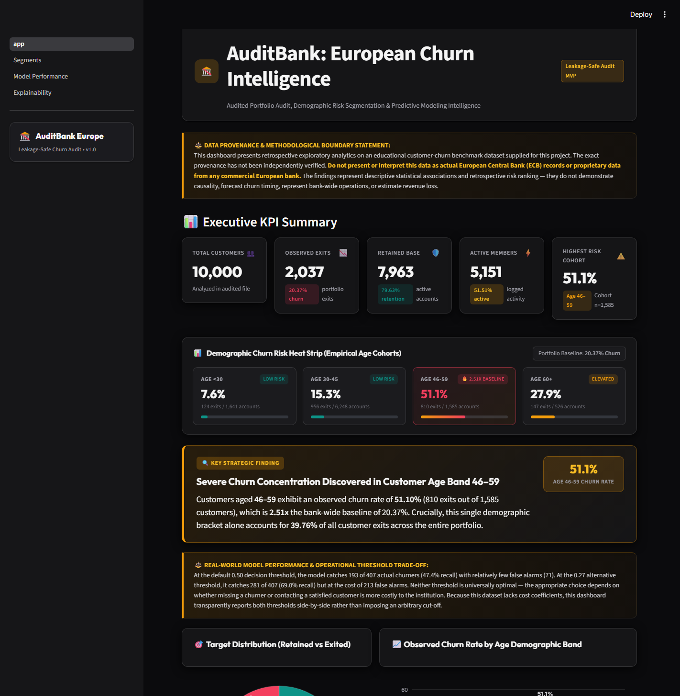
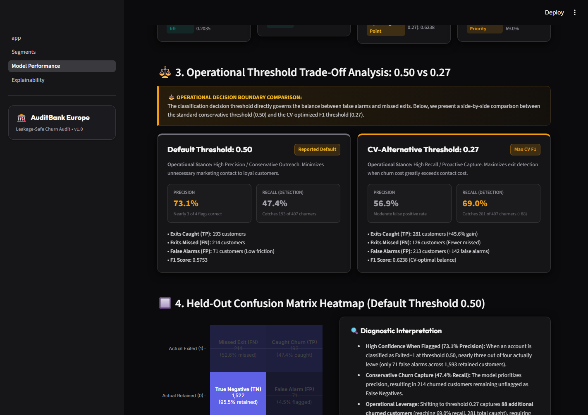

# AuditBank Europe: Leakage-Safe Customer Churn Intelligence MVP

A reproducible, leak-free customer churn risk modeling and multi-dimensional segmentation platform for retail banking portfolios.

[](https://www.python.org/)
[](LICENSE)
[](https://european-bank-churn-jsd5kuzbd98wuc4wkvd2lg.streamlit.app/)
[](https://github.com/Atharva110409/european-bank-churn)
[](tests/test_pipeline.py)

🔗 Live Demo: https://european-bank-churn-jsd5kuzbd98wuc4wkvd2lg.streamlit.app/


*Live dashboard — Overview page*

---

## 1. Executive Summary & Headline Findings

Retail customer churn in this 10,000-customer benchmark portfolio is heavily concentrated in a specific demographic segment: **customers aged 46 to 59 display an observed churn rate of 51.10%** (810 exits out of 1,585 accounts), representing **2.51 times the bank-wide baseline of 20.37%**. While this age bracket accounts for only 15.85% of total accounts, it contributes **39.76% of all customer departures** in the entire portfolio. In addition, accounts with dual product holdings experience high retention (only 7.58% churn), whereas single-product accounts churn at 27.71%.

### The Operational Threshold Reality: Association, Not Causation
We developed and evaluated a leak-free classification pipeline using 5-fold training cross-validation and a 2,000-customer held-out test split. The winning architecture, **Histogram-based Gradient Boosting**, achieved a test **Average Precision (AP) of 0.6980** (versus 0.2035 baseline) and **ROC-AUC of 0.8578**.

However, machine-learning accuracy alone cannot establish operational policy:
- **At the default 0.50 threshold:** The model achieves high precision (**73.1%**) with only 71 false alarms, but catches only **193 of 407 actual churners (47.4% recall)** — **missing over half of all departures (52.6% missed)**.
- **At the alternative 0.27 threshold:** The model catches **281 of 407 churners (69.0% recall)**, but at the cost of **213 false alarms** (precision drops to 56.9%, with 31.0% missed).

> **Methodological Disclosure:**  
> Neither threshold is automatically correct; the choice depends entirely on whether missing a churner or contacting a loyal customer is more costly to the institution. Furthermore, all model metrics and feature attributions represent **statistical associations**, not causal proof.

---

## 2. Repository Architecture

```text
european-bank-churn/
├── app/
│   └── dashboard.py               # Mirror entrypoint for modular deployment
├── pages/
│   ├── 1_Segments.py              # Cohort tables & charts (n < 300 flagged, zero-result safe)
│   ├── 2_Model_Performance.py     # CV ladder, test curves, threshold comparison (0.50 vs 0.27)
│   └── 3_Explainability.py        # Global SHAP beeswarm plot & permutation importance cross-check
├── data/
│   └── raw/
│       └── European_Bank.csv      # Local benchmark CSV (10,000 rows, 14 cols, preserved unmodified)
├── docs/
│   ├── assumptions.md             # Complete log of engineering decisions, audit rules, and cutoffs
│   └── data_provenance.md         # Full background on benchmark origin and analytical boundaries
├── models/
│   └── model.joblib               # Deserializable fitted winning pipeline artifact
├── reports/
│   ├── research_paper.md          # Full academic-style technical paper with empirical results
│   ├── executive_summary.md       # One-page non-technical briefing for banking leadership
│   ├── model_baseline_ladder.csv  # Side-by-side performance metrics across all candidate models
│   ├── model_confusion_matrices.md# Diagnostic breakdown of classification matrices and cost trade-offs
│   ├── shap_summary_global.png    # High-resolution global SHAP value attribution plot
│   └── segment_tables.csv         # Exportable summary tables across all four cohort dimensions
├── src/
│   ├── __init__.py                # Package initialization
│   ├── data_validation.py         # Schema validation, missing cell checks, range audits, feature policy
│   ├── segmentation.py            # Reusable demographic, geographic, and product summary functions
│   ├── train.py                   # Stratified 80/20 split, 5-fold CV, mean AP selection protocol
│   ├── evaluate.py                # Single held-out test evaluation, metric exports, curve data
│   ├── explainability.py          # Standalone post-hoc SHAP and permutation importance generation
│   ├── statistics.py              # Chi-square tests, Benjamini-Hochberg FDR, and bootstrap CIs
│   └── ui_theme.py                # Shared glassmorphism CSS styling and theme components
├── tests/
│   ├── __init__.py                # Test package initialization
│   └── test_pipeline.py           # Automated unit tests covering all 8 quality gates
├── .streamlit/
│   └── config.toml                # Cloud deployment server and dark-theme configuration
├── app.py                         # Root Streamlit Overview entrypoint (KPI cards & headline callouts)
├── requirements.txt               # Dependency specifications with pinned compatibility bounds
├── SUBMISSION_SUMMARY.md          # One-page standalone verification and audit summary
└── README.md                      # Comprehensive project documentation
```

---

## 3. Installation & Setup

### Prerequisites
- Python 3.10 or 3.11
- Git

### Commands
```bash
# 1. Clone repository
git clone https://github.com/atharva-code/european-bank-churn.git
cd european-bank-churn

# 2. Create isolated virtual environment
python -m venv .venv

# 3. Activate virtual environment
# Windows (PowerShell):
.\.venv\Scripts\Activate.ps1
# macOS/Linux:
source .venv/bin/activate

# 4. Install dependencies
pip install -r requirements.txt
```

---

## 4. Pipeline Execution

Run each stage sequentially to reproduce data validation, model selection, held-out evaluation, and explainability:

```bash
# Stage 1: Data Validation & Schema Audit
# Proves: Raw data contains exactly 10,000 rows, 14 columns, 0 nulls, 0 duplicate IDs, and enforces feature exclusions.
python -m src.data_validation

# Stage 2: Segment Summaries Export
# Proves: Mathematically verifies that all segment cohorts sum to 10,000 customers and 2,037 exits.
python -m src.segmentation

# Stage 3: Cross-Validation & Candidate Model Selection
# Proves: Evaluates 5-fold CV on training data only; verifies HistGradientBoosting wins by +0.0737 AP over 0.01 margin.
python -m src.train

# Stage 4: Held-Out Test Evaluation & Artifact Persistence
# Proves: Evaluates winning model once on held-out test data (AP=0.6980, ROC-AUC=0.8578) with zero test-set leakage.
python -m src.evaluate

# Stage 5: Explainability & Feature Attribution
# Proves: Computes global TreeExplainer SHAP values and permutation importance on held-out test data.
python -m src.explainability
```

---

## 5. Dashboard Architecture & Launch

### Launch Command
```bash
streamlit run app.py
```
Open your browser at `http://localhost:8501`.

### Page Flow Architecture
```text
+-----------------------------------------------------------------------------------+
|                        European Bank Churn Analytics                              |
+-----------------------------------------------------------------------------------+
| [Overview]                 [1_Segments]              [2_Model_Performance]       |
| - Total Customer KPIs      - Geography Breakdown     - 5-Fold CV Ladder Table     |
| - Target Distribution      - Age Bands (<30 to 60+)  - Test AP & ROC-AUC Curves   |
| - Age 46-59 Churn Finding  - Product Depth (n<300)   - Threshold Matrix (0.50/0.27)|
| - Real-World Recall Caveat - Activity Comparison     - Confusion Matrix Heatmap   |
+----------------------------+-------------------------+----------------------------+
| [3_Explainability]                                                                |
| - Global SHAP Value Summary Plot (TreeExplainer on HistGradientBoosting)          |
| - Permutation Importance Cross-Check Table (AP drop on held-out test data)         |
| - Predictive vs. Causal Methodological Disclaimer                                 |
+-----------------------------------------------------------------------------------+
```

---

## 6. Model Selection & Evaluation Summary

### 5-Fold Training Cross-Validation Comparison
Evaluated on the 8,000-record training partition (`random_state=42`):

| Model Architecture | Preprocessing Pipeline | Mean CV AP ± Std | Mean CV ROC-AUC ± Std | Protocol Decision |
| :--- | :--- | :--- | :--- | :--- |
| **DummyClassifier** | Naive Prior Baseline | 0.2037 ± 0.0000 | 0.5000 ± 0.0000 | Reference Baseline |
| **LogisticRegression** | Scaled + Sparse One-Hot | 0.6168 ± 0.0181 | 0.8314 ± 0.0116 | Candidate (Linear) |
| **HistGradientBoosting** | Scaled + Dense One-Hot | **0.6905 ± 0.0270** | **0.8566 ± 0.0110** | **Selected Winner** |

*Selection Rule Outcome:* HistGradientBoosting outperformed Logistic Regression by **+0.0737 AP**, comfortably exceeding the 0.01 AP margin where Logistic Regression would have been chosen for linear simplicity.

### Final Held-Out Test Evaluation (2,000 Records)
- **Average Precision (AP):** **0.6980** (versus 0.2035 Dummy baseline)
- **ROC-AUC:** **0.8578** (versus 0.5000 Dummy baseline)

### Operational Threshold Comparison & Confusion Matrix
Evaluated on 407 actual exits and 1,593 retained customers in held-out test data:


*Live dashboard — Model Performance page*

| Dimension | Default Threshold (0.50)<br>*(Prioritizes Precision)* | CV-Tuned Alternative (0.27)<br>*(Prioritizes Detection)* |
| :--- | :--- | :--- |
| **Precision** | **73.11%** | **56.88%** |
| **Recall (Detection Rate)** | **47.42%** | **69.04%** |
| **$F_1$ Score** | **0.5753** | **0.6238** |
| **True Positives (Exits Caught)** | 193 / 407 | 281 / 407 |
| **False Negatives (Exits Missed)** | **214 (52.6% missed)** | **126 (31.0% missed)** |
| **False Positives (False Alarms)** | 71 | 213 |
| **True Negatives (Correct Stay)** | 1,522 | 1,380 |

---

## 7. Limitations & Methodological Disclosures

1. **Static Cross-Sectional Snapshot:** This dataset contains a single observation per customer with no time index. It is a retrospective classifier, not a prospective forecasting tool; it cannot predict *when* a customer will churn.
2. **Substantial Churn Omission:** At the default 0.50 threshold, the model misses 52.6% of churning customers. At the alternative 0.27 threshold, it still misses 31.0%.
3. **Statistical Association, Not Causality:** Feature correlations (e.g. age 46–59 exit rate or German account churn) are descriptive patterns, not proof of cause. SHAP values reflect predictive mathematical reliance, not causal levers.
4. **No Financial or Intervention Data:** The dataset contains no customer lifetime value (LTV), balance margins, or outreach costs. No revenue-at-risk or marketing ROI claims should be derived from this analysis.
5. **Unverified Dataset Provenance:** As stated verbatim from project inception: *The file resembles the widely circulated educational Churn_Modelling benchmark, but the exact provenance of this specific CSV has not been independently verified. Describe it as an educational customer-churn dataset supplied for this project. Do not present it as actual European Central Bank data or proprietary records from a European bank.*

---

## 8. Reports & Publications

- **[Technical Research Paper](reports/research_paper.md):** Academic-style paper detailing the formal experimental protocol, statistical derivations, and cohort findings.
- **[Executive Summary](reports/executive_summary.md):** High-level strategic briefing designed for bank leadership and retention operations.
- **[Confusion Matrix Analysis](reports/model_confusion_matrices.md):** Detailed diagnostic matrix breakdown and asymmetric cost formulation.
- **[Model Baseline Ladder](reports/model_baseline_ladder.csv):** Raw exportable CSV comparing candidate model metrics side by side.
- **[Segmentation Data Export](reports/segment_tables.csv):** Raw CSV containing full demographic, geographic, and product summaries.
- **[Modeling Assumptions Log](docs/assumptions.md):** Detailed rationale for all non-obvious engineering choices and cutoffs.
- **[Data Provenance Brief](docs/data_provenance.md):** Expanded disclosure of dataset boundaries and ethical governance.

---

## 9. License

Distributed under the MIT License. See `LICENSE` for details.
